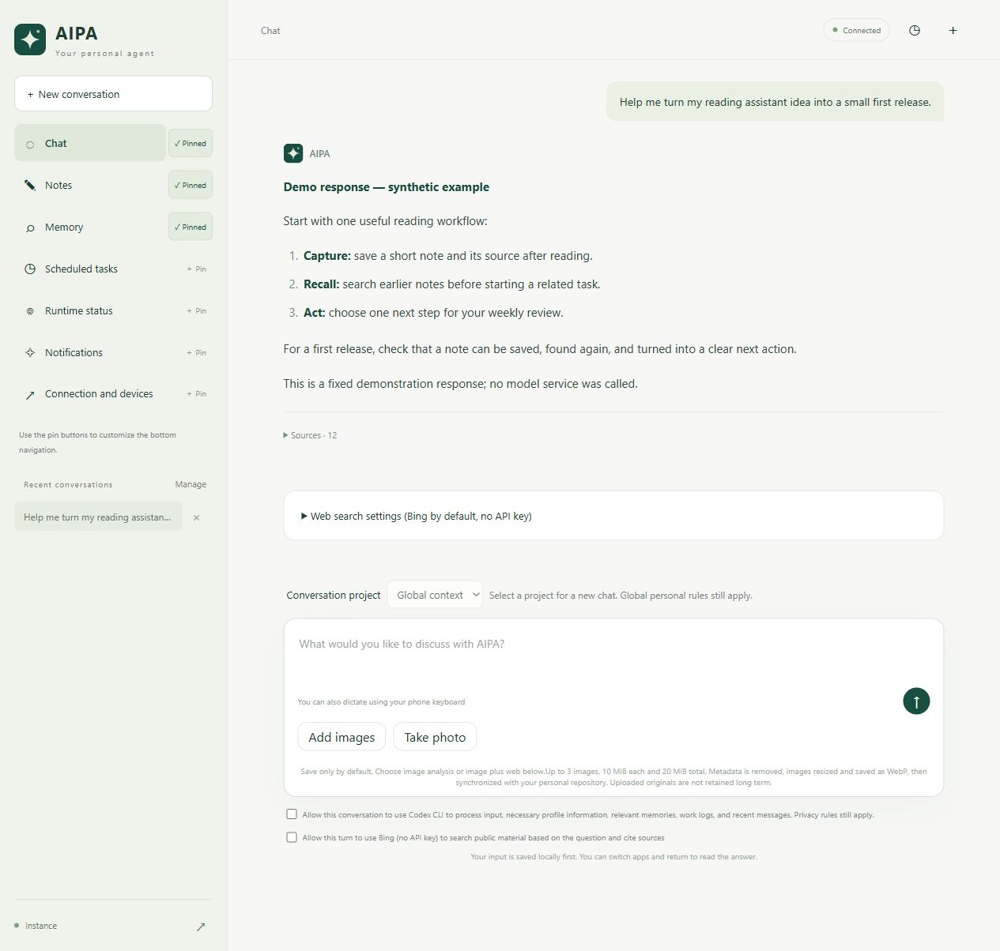
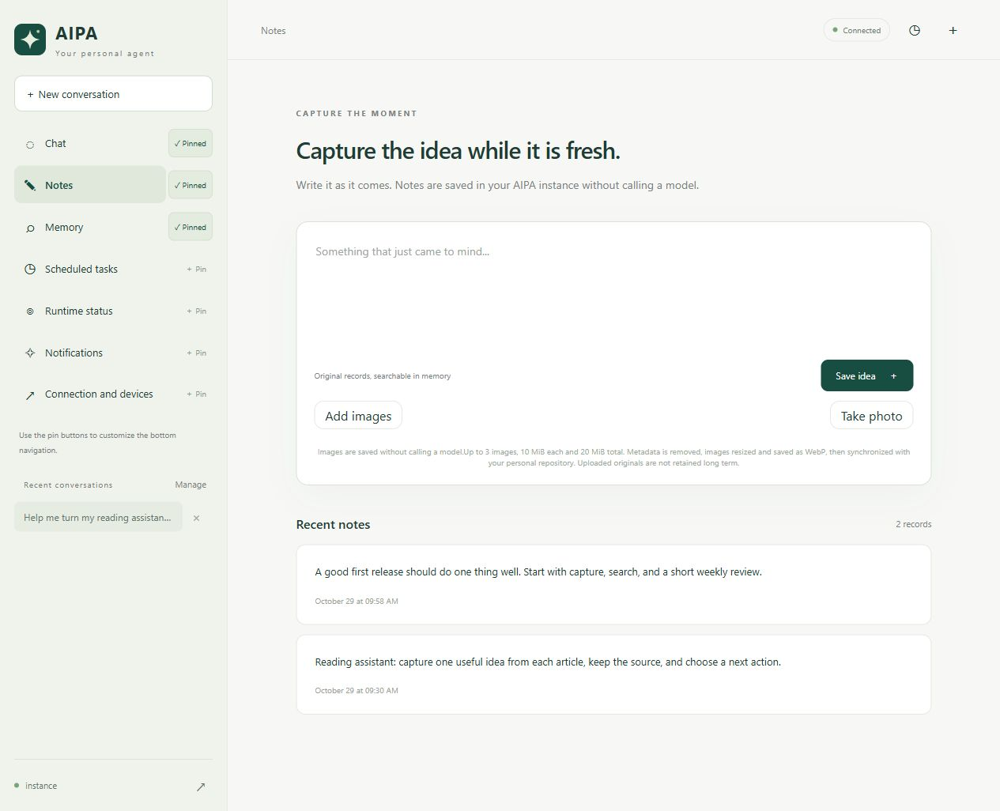
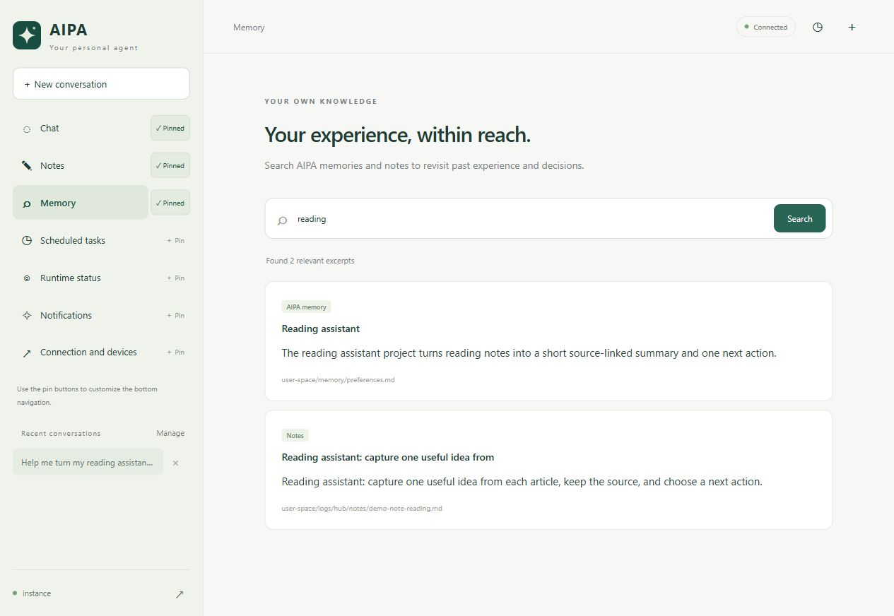
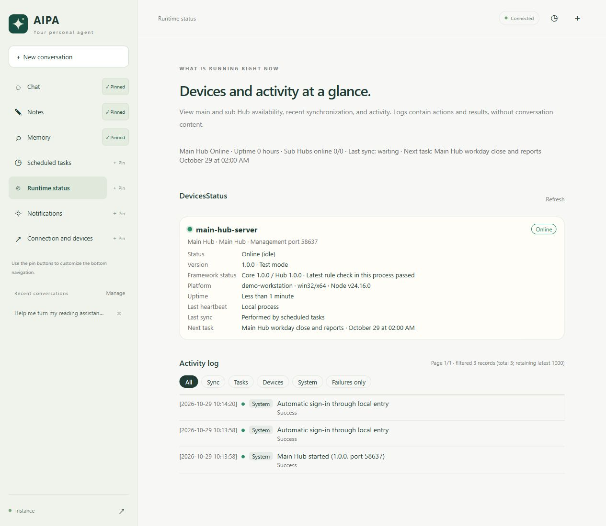

# AIPA Hub

[English](README.md) · **简体中文**

AIPA Hub 1.1.0 为私人 AIPA 助手提供 Web 界面和可选常驻服务。个人知识与对话保存在自己的实例中，你可以选择受支持的模型执行器，通过浏览器访问助手。

## 功能

- 基于个人档案、记忆与指定项目对话，展示来源，必要上下文缺失时明确报错。
- 保存随手记，管理对话和附件，检索相关记忆。
- 配置提供商并授权后，处理图片问题与公开网页信息。
- 管理日程，生成日报和可选新闻简报，统一使用实例时区。
- 审核记忆变更提议，恢复中断操作，避免静默重复模型请求。
- 可选地连接另一台电脑上的子 Hub，通过私人 Git 仓库同步实例。
- 在中文或英文 Web 界面查看服务状态、任务、冲突与恢复操作。

界面支持简体中文和英文；源码与命令行提示为英文。模型回答可使用用户语言；具体模型、图片与语言能力取决于执行器和提供商。

## 网页功能预览

截图使用独立演示实例和合成资料，对话回复为固定示例。

### 带上下文的对话

结合相关个人上下文继续交流，查看回答使用的来源，并随时回到已有对话。每轮可选择是否允许联网检索或图片分析。



### 随手记

即时记录想法，按需附上图片，并浏览最近的笔记。保存时将原始内容写入自己的实例，无需调用模型。



### 记忆检索

按关键词搜索记忆与已保存的笔记。结果附带内容摘要和来源位置，方便回看原始上下文。



### 运行状态

查看主从 Hub 在线情况、Core 与 Hub 版本、同步状态和后续任务。可按类型筛选活动日志，检查执行动作与结果。



## 三个仓库的分工

| 仓库 | 用途 |
|---|---|
| [Personal](https://github.com/StriveJ/artificial-intelligence-personal-agent) | 安装 Core 模板，初始化自己的私人实例 |
| [Origin](https://github.com/StriveJ/artificial-intelligence-origin-agent) | 开发 Core、技能、模板、测试与构建工具 |
| [Hub](https://github.com/StriveJ/artificial-intelligence-personal-agent-hub) | 运行 Web 服务、计划任务与可选主从连接 |

Hub 程序、私人实例与设备本地运行配置应分别存放。只有主 Hub 也可使用 Web；子 Hub 是可选项，运行于另一台电脑，主动连接主 Hub，通过本机 IPC 提供接口，不监听 HTTP。各设备使用自己的私人实例检出与运行目录。

## 安装部署

准备 Node.js 24 或更高版本、Git 2.31 或更高版本，以及受支持的执行器：`claude`、`codex` 或受控 `harness` 适配器。先按照 [Personal 安装指南](https://github.com/StriveJ/artificial-intelligence-personal-agent#install) 初始化 AIPA 实例。单独验证执行器与所选模型账号可用；模型调用可能产生费用。

Windows 下建议使用较短的源码、实例和运行目录，例如 `D:/aipa/hub`、`D:/aipa/instance`、`D:/aipa/runtime`。Git 临时工作树与 SQLite 快照会继续增加路径层级。

```sh
git clone https://github.com/StriveJ/artificial-intelligence-personal-agent-hub.git
cd artificial-intelligence-personal-agent-hub
npm ci --ignore-scripts
```

将 `config.main.example.json` 复制到源码仓库以外的私人目录，编辑：

1. `root` 指向已初始化的实例，`runtimeDir` 指向另一私人状态目录，均使用绝对路径。
2. `engine` 选择已安装执行器，凭据保存在仓库外。
3. **首次启动前决定模式。** `testMode: true` 只用于可丢弃的合成实例；真实个人实例应显式设置 `testMode: false`。测试模式会在实例 Git 元数据中永久添加禁止推送标记，之后修改配置不能将测试实例转换为生产实例。
4. 启用同步前核对 `tasks.repo-sync` 和私人 Git 远端；不需要自动 Git 操作时关闭该任务。
5. 审核隐私和授权设置后，再启用需要模型的定时工作。

前台启动主 Hub：

```sh
node main-server.mjs --config /absolute/path/to/private/config.main.json
```

示例地址为 `http://127.0.0.1:14327`。在本机浏览器登录并检查状态。保持终端开启，或以独立用户配置操作系统服务管理器执行同一命令；修改源码和依赖前按 Ctrl+C 停止。运行目录包含配对凭据、会话和操作状态，应与实例一起私人备份。

### 远程访问

使用 HTTPS 反向代理或隧道。在主 Hub 私人配置中同时设置 `publicPort`（独立回环代理端口）和 `publicOrigins`（精确允许的 HTTPS 来源）。代理连接 `publicPort`，不要连接本机管理端口。通过本机页面或 SSH 本地转发获取配对码，远程客户端必须配对。本机管理端口应保持私有，隧道本身不提供 Hub 用户认证。

### 网站页脚与法律信息

在 **Scheduled tasks（计划任务）> Website footer and legal information（网站页脚与法律信息）** 中设置适用于本次部署的公开信息。可选的中国网站 ICP 备案号链接至工信部查询系统 `https://beian.miit.gov.cn/`；也可配置运营者说明、隐私政策、服务条款、法律声明、Impressum 或其他地区的登记查询链接。国内备案信息与通用法律链接可同时展示，所有访客看到相同配置。

私有配置接口默认全部留空：`"site": { "icpNumber": "", "footerText": "", "footerLinks": [] }`。每个链接项包含 `label` 和 `url`，最多八项；支持无凭据 HTTPS 地址或以单个 `/` 开头的本站路径。页脚文字支持换行，不接受 HTML。目标页面由部署者提供，Hub 不自动生成法律政策或核验登记状态。

页脚在登录前后均由服务端输出，关闭 JavaScript 也可见。Web 保存后即时更新，设置保存在设备本地运行目录的 `site-settings.json` 中，重启保留，并优先于初始私有配置。各项留空则隐藏；原有仅含 ICP 号码的配置仍兼容。移动端为底部导航预留空间。实际号码和法律信息由部署时提供，不提交公共源码，也不要填入凭据或私人信息；展示内容按运营主体、业务与适用地区要求确定。

### 可选子 Hub

在另一台电脑安装相同源码，单独检出私人实例，将 `config.sub.example.json` 复制到私人目录。在主 Hub 的 Devices 页面登记设备，填入 `mainUrl`、`nodeId`、`installationId` 与设备 `token`。设置本机独立的实例和运行目录绝对路径，以及可用执行器。真实实例首次启动前也应设置 `testMode: false`：

```sh
node sub-server.mjs --config /absolute/path/to/private/config.sub.json
```

源码子 Hub 的示例不设置 `managedBase`、`programDir` 或 `externalInstance`。普通源码部署支持同步和本机 IPC，不启用主 Hub 发起的远程清除；主 Hub 中的清除请求会返回受管安装要求。不要仅为启用按钮而手动添加这些字段。

受管生命周期单独配置：受管安装器创建专用安装目录与所有权记录，校验实例、运行和程序目录；目录外实例必须显式登记绑定。远程清除会删除该安装实际拥有的实例与运行目录，仅适用于已审阅这项所有权和删除范围的专用受管安装。源码发行不附带受信任的受管签名包。

不要提交真实配置、设备令牌、模型凭据、配对记录、运行目录或签名私钥。

## 语言与时区

所有默认界面文案统一登记在 `public/locales/en.js`。新增语言只需对照总表翻译，并在 `public/languages.js` 注册一次，菜单与语言资源路由会自动生成，无需逐页查找。运行 `npm run i18n:new -- ja` 可生成完整翻译模板，`npm run i18n:check` 检查词条和占位符。详细流程见[翻译维护说明](docs/localization.md)。

在登录页或网页顶部的 **界面语言（Interface language）** 中选择“跟随浏览器”“中文”或“English”。切换即时生效，无需刷新，保留未提交的输入和设置。选择保存在当前浏览器，并同步同站点的其他标签页；不支持的浏览器语言回退为英文。浏览器禁止存储时，当前页面仍可切换。聊天、模型回答、自定义名称和部署提供的页脚文字及链接均保留原文；服务端返回的技术诊断可能仍为英文。

界面语言与下方的模型回复语言设置互相独立。

在私人实例的 `user-space/overrides.yaml` 中设置：

```yaml
display:
  language: auto
```

`auto` 跟随当前输入语言，无法判断时使用英文。有效 BCP 47 标签（例如 `en`、`zh-CN`、`es`）可指定偏好，当前消息的明确语言要求优先。已存输入、笔记、引用和记忆保留原文，此设置不翻译界面。

在 `user-space/llm-provider.yaml` 设置共享 IANA `time_zone`，例如 `UTC` 或 `America/New_York`。Hub 定时任务与时间显示遵循该值；Hub 单独时区覆盖项应不设置，或与共享值相同。默认时区为 `Asia/Shanghai`。

关闭 `tasks.repo-sync.enabled` 也会阻止日报收尾和补报发起主从 Hub 的 Git 同步。本地报告仍可生成；已有的设备请求历史会保留，不会自动删除或伪造设备回执。

## 更新

Hub 程序与 Core 分别更新。源码安装流程：

1. 备份私人配置、运行目录和实例，阅读目标版本的说明与要求。
2. 停止 Hub，确认没有集成任务继续写入实例。
3. 保留旧程序目录供回退，在另一源码目录获取并检出已审核的版本标签，执行 `npm ci --ignore-scripts`。私人实例与运行目录路径保持原值。
4. 使用同一私人配置启动新程序，检查状态、对话和笔记，再恢复计划任务。
5. 验证失败时停止新进程，恢复旧程序与相配套的私人备份。恢复快照前，将升级后新写入的数据另行保存并核对。

不要覆盖运行中的安装或删除私人运行状态。不要在私人实例中用 `git pull` 更新 Hub。Core 使用 [Personal 更新指南](https://github.com/StriveJ/artificial-intelligence-personal-agent#update-your-instance)，更新 Core 不会更新 Hub。

本次 1.1.0 提供源码发行。受管安装与回退工具供维护者发布签名不可变包使用；源码标签不提供正式受管签名包，也不自动建立公钥信任。仅当发行提供独立核验的包、公钥指纹和安装说明时才使用受管安装，详见英文[包发布指南](docs/release-process.md)。

## 要求与边界

Hub 1.1.0 要求 Node.js ≥24，依赖 `sharp` 0.35.5，主从协议 1，运行格式 schema 1。完整契约见[英文 README](README.md#runtime-contract-and-limits)。Core 能力声明与服务配置共同决定功能，必要上下文或授权不满足时阻止相关操作。

默认上下文预算是 1 MiB 输入字节，不代表模型 token 窗口。通知指 Hub 持久收件箱，未包含系统推送、邮件和短信。未包含逐 token Web 流式输出、任意 Web 命令执行和远程批量软件升级。详见英文[计划任务和通知指南](docs/pushes.md)。

浏览器 Markdown 使用 Marked 和 DOMPurify。受控 Harness 适配器通过 `AIPA_HARNESS_ENTRY` 使用 `@deepseek-ai/dsh` 0.2.1-rc.2。安装 Hub 不会安装执行器或自动授予模型与网络访问许可。

## 开发

```sh
npm test
```

Core 集成测试默认使用同级 `artificial-intelligence-origin-agent` 检出，也可设置 `AIPA_ORIGIN_ROOT` 指向公共 Origin。支持跳过的测试在默认源码缺失时会明确标记；显式配置无效路径会失败。测试使用合成夹具和模型桩，除非显式启用可选受控执行器测试；不要指向私人实例。

## 联系我

如果你有什么建议与想法，可以发邮箱联系我：

- [1905212905@qq.com](mailto:1905212905@qq.com)
- [strivejun@gmail.com](mailto:strivejun@gmail.com)

## 许可

原创代码和文档采用 [Apache License 2.0](LICENSE)，包含第 3 条明确专利授权和专利诉讼终止条款。第三方组件保留各自许可，详见[浏览器组件声明](public/vendor/README.md)。安装 Hub 不会公开私人实例数据。
